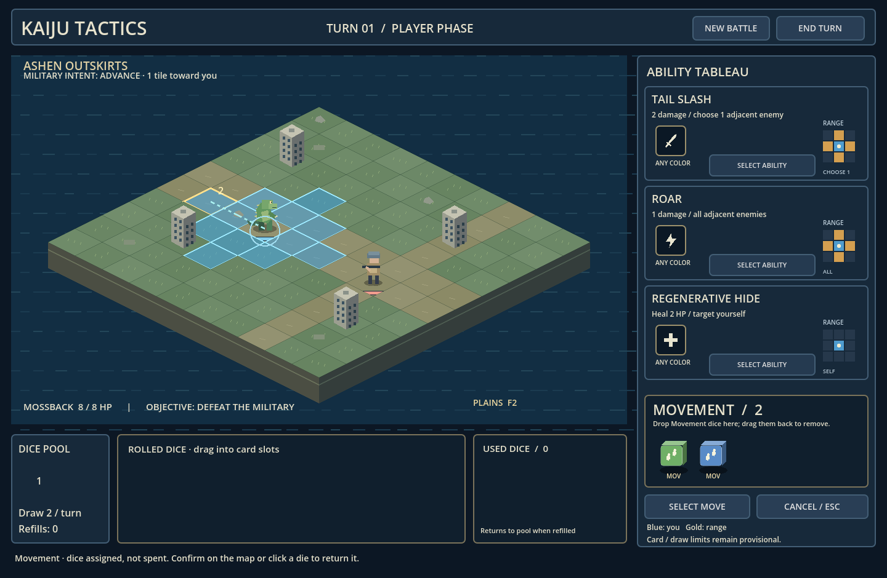

# Kaiju Tactics — basic systems in Godot

A playable Godot 4.6 foundation for the revised tabletop/tactical design: a dominant isometric map, compact side-panel ability slots and range grids, and open dice trays along the bottom.



This image is captured from the running project. [The approved visual concept](design/battle-screen-mockup-03.png) remains the art/layout target; the runtime currently uses original procedural placeholder terrain, buildings and characters. It does not reproduce the concept art's finished asset quality.

## Run

Import `project.godot` into **Godot 4.6 standard edition**, then press **F5**. No .NET, addons, network services or credentials are needed. Or run `godot --path .` from this directory.

At turn start, two dice are randomly drawn without replacement from a three-die pool. Watch them roll onto the map's rolling surface, settle on their actual results, and travel to the bottom tray. Commands unlock after this finishes. The draw count is prototype tuning in `data/content.gd`, not a final design decision.

## Play

- **Abilities:** drag a die from the open Rolled tray into a card's individual payment slot. The symbol must match; a colored slot also requires that color. A die from any card can pay any compatible slot. Hover a die for its color, symbol and unique ID.
- **Activate:** assigning dice selects the ability and highlights legal map targets. Click a target to confirm payment and effect. Filled slots alone do not consume dice. Select Ability/Choose Target can reactivate a previously staged card.
- **Remove payment:** drag an assigned die back to the Rolled tray, or click it. Escape / Cancel returns the current action's assigned dice. Other cards keep their own staged payments.
- **Movement:** drag any number of Movement dice into the open Movement area. The large number is your movement allowance. Drag a die back out to reduce it. Reachable tiles update immediately; hover a destination to preview its continuous path and length. Click once to move the whole route. Only path-length dice enter Used; extra Movement dice return to Rolled unspent.
- **End Turn / Space:** all remaining rolled, card-assigned and movement-assigned dice enter Used. The infantry executes its intent. The next player turn draws again.
- **Refill:** draw from the remaining pool first. Only when it empties are Used dice returned to it. Already drawn dice are never redrawn during the same turn.
- **Win/lose:** defeat the infantry, or lose when Mossback reaches zero HP. New Battle / Play Again restarts with a new seed.

Buildings are impassable, units occupy one tile each, and movement is orthogonal. Enemy pathfinding routes around occupied/blocked tiles. Enemy intent is shown above the map; adjacent attacks also have a threat line. Ability ranges are displayed as top-down square grids: blue is the player, gold is range.

Starter cards are the GDD's **Tail Slash**, **Roar**, and **Regenerative Hide**, each contributing its own exact six-sided die. Their descriptions and distributions live in content data. Defense faces are visible but have no spend action yet. There are no free dice, free movement, rerolls, draft rewards, bosses or campaign systems in this pass. Three visible cards and two drawn dice are provisional tuning; an equipped-card limit has not been finalized.

## Architecture

- `data/content.gd`: starter cards/dice, scenario, units and draw count.
- `scripts/zones.gd`: modular zone registry, membership, capacity/symbol/color constraints, availability and lifecycle policies, transfer events. Every die owns exactly one zone ID.
- `scripts/battle.gd`: draws, refill, seeded RNG, per-card slot zones, multi-die movement, payment, healing/damage, enemy phase and objectives.
- `scripts/rules.gd`: distinct-die matching, geometry and deterministic pathfinding.
- `scripts/main.gd`: map-led HUD, open trays, per-slot drag/drop, zone-transfer animations, rolling-to-tray sequence and input locks.
- `scripts/die_view.gd`, `symbols.gd`: small simulated-3D cubes and shared resource pictograms. Cosmetic animation never changes gameplay RNG/results.
- `scripts/cost_slot.gd`, `drop_zone.gd`, `range_view.gd`: payment destinations, drag validation and top-down range diagrams.
- `scripts/board.gd`: isometric picking, placeholder island/buildings/sprites, tile/path previews, unit path animation and threat markers.

See [zone extension notes](docs/ZONES.md) and [current assumptions](DESIGN_ASSUMPTIONS.md).

## Validation

Verified with **Godot 4.6.3**: clean project import and **79 automated checks passing**, including 50 complete seeded battles. Tests cover generic/colored/mixed payments, exact slot membership, zone transfers and availability, custom reserve zones, pool exhaustion/refill, short draws, turn cleanup, movement add/remove and leftover returns, continuous paths, blockers, enemy pathfinding, healing, terminal states, UI locks, stale drags, picking and restart safety. The battles are deliberately easy; passing simulations are not balance approval.

```sh
godot --headless --path . --editor --import --quit
godot --headless --path . --script res://tests/run_tests.gd
```

The separate graphical smoke test uses real mouse press/drag/release events. It verifies dragging into and out of card slots, adding/removing Movement dice, spending less than the allocated movement, and end-turn transfers. It saves actual runtime screenshots under Godot's user data directory.

```sh
godot --path . --audio-driver Dummy --script res://tests/presentation_smoke.gd
```

This passed on a virtual Xorg display with Mesa software rendering. Native desktop export and a human balance playtest are not claimed.

On the cloud machine, set writable XDG paths before running commands:

```sh
export XDG_CACHE_HOME=/workspace/.cache
export XDG_DATA_HOME=/workspace/.local/share
export XDG_CONFIG_HOME=/workspace/.config
mkdir -p "$XDG_CACHE_HOME" "$XDG_DATA_HOME" "$XDG_CONFIG_HOME"
```

## Next review

Test map/card/tray proportions, die readability, the movement counter interaction, draw pacing and zone circulation before expanding content. Dice currently use simulated 3D rather than physics-driven meshes. The pool is shown as a count rather than individual cubes; additional zones have model support but need an intentional UI when introduced. The sidebar currently lays out three starter cards; a larger collection needs scrolling/equipment decisions. There is no hard card cap or run progression yet.
