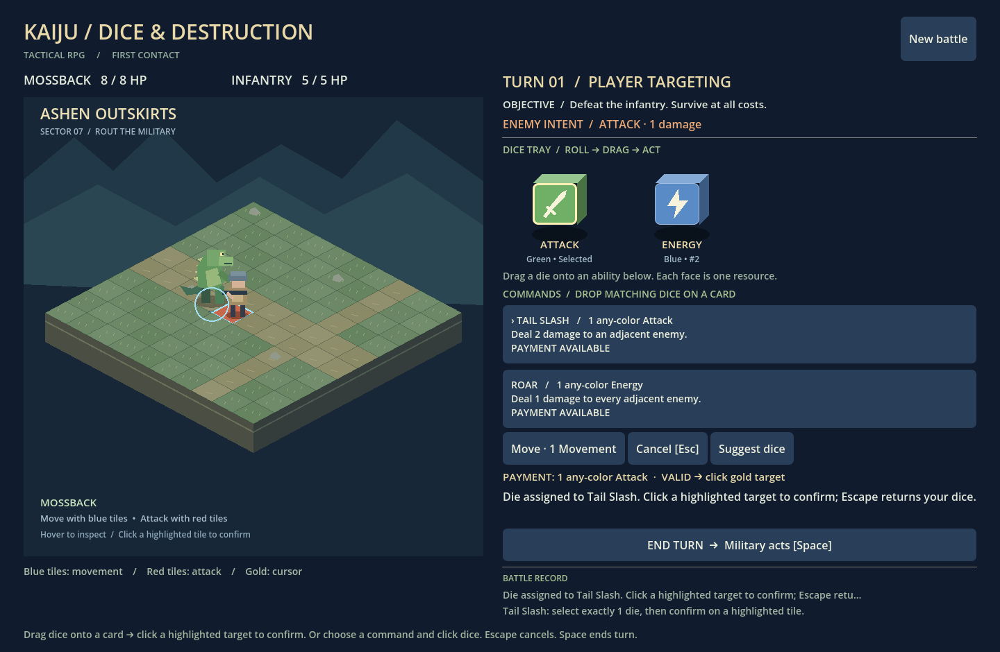

# Kaiju / Dice & Destruction

An isometric tactical RPG presentation of the **Godot 4.6** Milestone 1 prototype based on the supplied Kaiju Tactical Dicebuilder GDD and implementation prompt. One short tactical battle: roll two colored dice, spend their symbols to move and activate visible abilities, and defeat the infantry before it defeats you.



## Open and play

1. Install Godot 4.6 standard edition (no .NET required).
2. Import `project.godot` and press **F5** to run the main scene.
3. Watch the green and blue dice tumble, bounce and settle into their rolled symbols. Commands stay locked until the roll finishes.
4. **Drag a die onto Tail Slash, Roar, or Move** to stage that exact die as payment. Add dice one at a time for multi-die costs; incompatible, duplicate and spent dice are rejected. Alternatively choose a command and click dice, or use **Suggest dice**.
5. Click a highlighted tile to confirm payment and effect: blue for movement, red for attacks. Dropping onto a card alone never spends dice; cancellation or an invalid target consumes nothing.
6. **Cancel / Escape** clears targeting without cost. **End Turn / Space** discards remaining rolls, executes the displayed enemy intent, then rolls the pool for the next turn.
7. Reach victory or defeat and select **Play again**. **New battle** restarts at any time.

One Movement face buys one orthogonal tile. Tail Slash costs any-color Attack and deals 2 adjacent damage; Roar costs any-color Energy and deals 1 to all adjacent enemies. Dice from either card may pay either card. Defense/Regeneration are intentionally unused until the next milestone. All cards remain visible; there is no draw/discard pile.

Command line from this directory:

```sh
godot --path .
```

On this cloud machine, use writable XDG directories to avoid home-directory sandbox errors:

```sh
export XDG_CACHE_HOME=/workspace/.cache
export XDG_DATA_HOME=/workspace/.local/share
export XDG_CONFIG_HOME=/workspace/.config
mkdir -p "$XDG_CACHE_HOME" "$XDG_DATA_HOME" "$XDG_CONFIG_HOME"
godot --path /workspace/KaijuTacticsPrototype
```

A graphical session/display is required for interactive play. No network, credentials, plugins or package installation are required. Headless validation needs no display:

```sh
godot --headless --path . --editor --import --quit
godot --headless --path . --script res://tests/run_tests.gd
```

## Implementation boundaries

- `data/content.gd`: theme labels, starter ability/die definitions, units and scenario.
- `scripts/rules.gd`: theme-neutral backtracking cost allocation and movement geometry.
- `scripts/battle.gd`: seeded rolls, unique dice, explicit phase machine, payment, targeting, effects, deterministic enemy turns and objectives.
- `scripts/board.gd`: isometric terrain diorama, original drawn character sprites, idle/move animation, health bars, tile picking and targeting overlays. Terrain details are cosmetic; all tiles remain passable.
- `scripts/die_view.gd`: cube rendering, face icons, timed tumbling animation and native Godot drag previews/payloads. Cosmetic animation never changes the seeded result.
- `scripts/card_view.gd`: native drop-target validation and payment staging on command cards.
- `scripts/main.gd`, `main.tscn`: controls, payment preview, enemy intent, history, restart and result panels.
- `tests/run_tests.gd`: executable rules, battle simulation and production-scene integration tests.
- `DESIGN_ASSUMPTIONS.md`: provisional interpretations and balance choices.

The battle rules inspect generic action fields, not Tail Slash/Roar names. Content and labels can be replaced without editing payment or combat algorithms. This is a small data boundary, not a content-pack framework.

## Verification

Developed and run with Godot **4.6.3 stable**. **54 automated checks passed, with zero failures**, including 50 seeded battle simulations. The test harness exits nonzero on failure. It covers colored/generic overlap, three-distinct-die costs, mixed symbols, wrong colors, duplicate/spent/extra dice, cancellation, invalid targets, movement bounds/occupancy/blockers, cross-card dice use, both attack effects, enemy intent/advance, turn reset, seeded replay, terminal state guards and actual UI control signals. It simulates 50 naturally rolled battles, tests defeat by passing, and tests restart while an enemy timer is pending.

The graphical application was also launched using an Xorg dummy display with Mesa software rendering and visually inspected. This establishes native rendering/startup here, not a human balance playtest or a platform export. No browser, Windows or macOS export is claimed.

### Manual smoke test

- Confirm only the green and blue starter dice appear and roll at turn start.
- Drag a Movement die onto Move and click an adjacent blue tile. It moves one tile and spends that exact die. A diagonal/occupied tile does nothing.
- Cancel targeting and verify the pool is unchanged. Select the wrong symbol and verify payment is rejected.
- Let infantry approach; inspect its intent. It advances until adjacent, then attacks on later phases.
- Pay Attack for Tail Slash or Energy for Roar while adjacent; verify damage and spent dice. A blue Attack may pay Tail Slash.
- Win using attacks; restart and pass repeatedly to reach defeat. Both panels should permit a new battle.

## Proposed Milestone 2 (not implemented)

Add tank/helicopter data, blocking terrain with appropriate pathing, colored signature and mixed-symbol abilities, line/area targeting, and explicit defense/regeneration actions. Drafting and a second encounter remain Milestone 3. Review this slice before expanding scope.

## Presentation update

Original isometric diorama and small drawn kaiju/infantry sprites replace letter tokens. Dice are visibly colored cubes with sword, footprints, lightning, shield and regeneration icons. At each turn start they tumble with changing faces, bounce, stagger and settle on the actual model result. Dragging uses native Godot drag-and-drop; cards accept only compatible partial payments from the current battle. The release only allocates resources; a legal target confirms spending. No dice distribution, movement cost or combat balance changed.

Native graphical drag-and-drop and rendering smoke test (requires a display):

```sh
godot --path . --audio-driver Dummy --script res://tests/presentation_smoke.gd
```

This simulates a real mouse press/drag/release from a die onto a card and verifies the selected payment. It also saves rolling, dragging and settled screenshots in Godot’s user data directory. This check passed on the virtual Xorg display in addition to the 54 headless checks.
