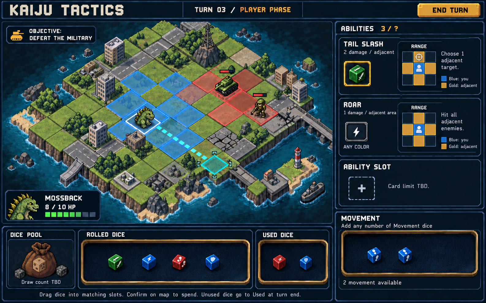
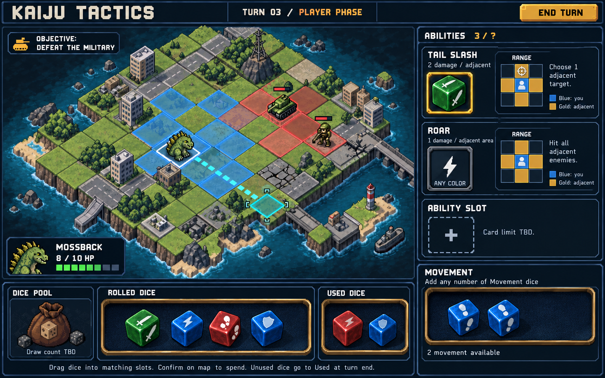
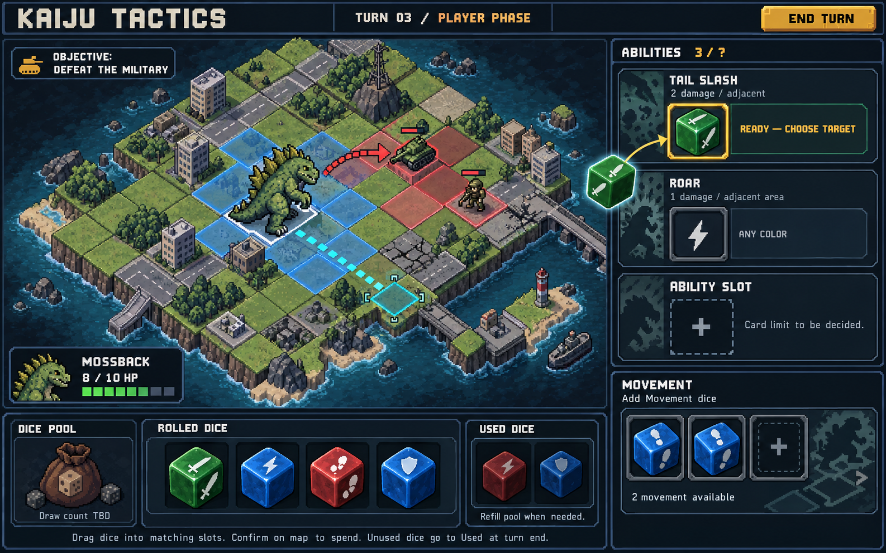

# Battle-screen concept 03 — visual starting point

Revision requested: reduce dice and dice-payment slots to approximately half their previous size. Dice now occupy less of each open shared tray; payment sockets are more compact. Keep range diagrams and text readable at full size. The map-led composition, single-tile standard units, side-panel cards, top-down square range diagrams and open dice trays remain the design direction. The image is approximate concept art; implementation should target 50% linear dice/slot scaling relative to concept 02.

This is the visual starting point for continued design review, not authorization to resume or expand gameplay implementation. No gameplay code changed. Draw count, card limit, exact zone behaviors beyond the agreed cycle, and final assets remain to be settled.

---

## Earlier revisions

# Battle-screen concept 02 — for design review

Latest requested changes:
- Standard characters occupy one tile. Larger footprints are reserved for explicitly designed future bosses.
- Rolled, used, and movement dice sit together in continuous open trays, without individual dice sockets. Each die can be clicked and dragged.
- Ability cards retain individual symbol/color payment slots.
- Ability ranges use small top-down square grids: blue marks the player, gold marks orthogonally adjacent squares. Tail Slash chooses one adjacent target; Roar affects all adjacent targets.

This remains static concept art. No gameplay code was changed. The map route and resource counts are illustrative and must not be treated as a validated movement preview or finalized balance. Draw count, equipped-card count, and colored-slot visuals remain open for later design review.

---

## Previous concept

# Battle-screen concept 01 — for design review

Static concept art, not a running screenshot or a promised asset set. The playable prototype has not been modified. The image explores an original pixel-art isometric map, right-hand cards and movement allocation, physical-looking dice and bottom pool/rolled/used zones. The moving die illustrates drag-to-slot assignment, not a duplicate resource.

Agreed mechanics: draw from the pool at turn start; roll visibly before transferring dice into the bottom tray; match symbols and optional colors in ability slots; stage multiple Movement dice and spend only the distance actually traveled; spent dice go to Used; all remaining rolled/assigned dice go to Used at turn end; refill the pool from Used when needed. Dice locations are modular zones. No combat implementation changes are implied by the concept.

Review priorities:
- Map/sidebar/tray proportions and pixel-art direction.
- Card readability, payment-slot size, and how many equipped cards fit comfortably.
- Movement allocation in the sidebar versus the bottom tray.
- Contrast between dimensional dice and the pixel-art map.

Card count, draw count, unit HP, terrain mechanics, route length and other illustrative numbers are not finalized. The two-die movement label and route are visual placeholders, not a validated path preview. The enemy arrow is also illustrative. Card slots in this first image demonstrate generic costs; colored-cost slots still need a visual example. Exact dice distributions must come from approved content, not the illustration.

Next step is user review and revision of the static design. Do not expand gameplay based on this mockup before that review.
